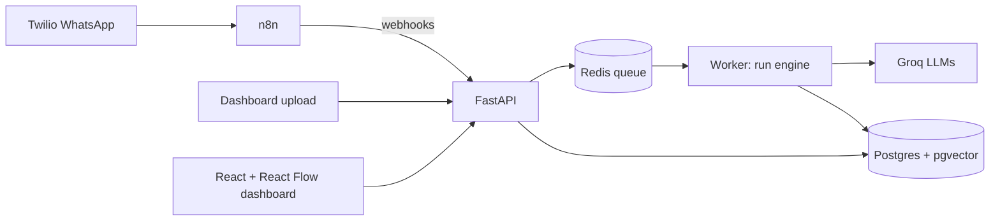

# AutoHub

One hub where AI automations run, every run traced step by step, with a human in the loop when the AI isn't confident.

**Automations**
| Automation | Trigger | What it does |
|---|---|---|
| Lead Handler | Email, WhatsApp, website form | Qualifies leads for flowpath (a marketing studio), replies in English, Roman Urdu, Urdu or Arabic from its knowledge base, auto-sends or queues for approval |
| Document Extractor | File upload | Vision extraction of invoices/receipts → validation → self-correction → human review |
| Daily Digest | n8n schedule (9 am) | Morning WhatsApp summary: new and hot leads, replies waiting for review, failed runs, AI cost |

## Architecture



**Core design:** every execution is a `Run` made of `RunStep`s. Each step stores input, output, model, tokens, cost, duration and retry count. Step ids match the node ids in each automation's React Flow graph, so the dashboard can replay any run on its diagram.

## Stack
FastAPI · SQLAlchemy · Postgres + pgvector · Redis + RQ · Groq · Gmail (SMTP/IMAP) · WhatsApp Cloud API (Meta) / Twilio · n8n · React + Vite + React Flow · Render

## Run locally
```bash
cp .env.example .env          # add GROQ_API_KEY later (Phase 1)
docker compose up --build
```
- API docs: http://localhost:8000/docs
- Health: http://localhost:8000/health
- Smoke test the engine: `POST /api/automations/system_check/runs`, then `GET /api/runs/{id}`
- Try the Lead Handler with 9 sample leads in 4 languages: `docker compose exec api python scripts/demo_leads.py`

## Lead Handler
```
intake → classify → retrieve → qualify → draft → check + route ─┬─ auto ─→ send ─┬→ save lead
           └─ spam ───────────────────────────────────────────────┤               │
                                                                  └─ review → approval (approve / edit / reject)
```
- **classify** (gpt-oss-20b): intent, language, and an English search query
- **retrieve**: BM25 over flowpath's site content (`app/knowledge/flowpath.py`)
- **qualify** (gpt-oss-20b): extracts services, budget, urgency; code scores the lead on flowpath's budget bands
- **draft** (gpt-oss-120b): reply in the customer's language and style, only from retrieved passages
- **check + route**: an LLM judge labels each claim (fact, commitment, restatement, courtesy) and whether it's supported; code computes confidence from the facts and commitments only, then applies the rules: unsupported claims, invented prices, review languages, existing clients, unoffered services
- **approval**: `GET /api/approvals`, `POST /api/approvals/{id}/decision` with `approve`, `edit` or `reject`

Endpoints: `POST /api/leads/inbound` · `GET /api/leads?temperature=hot` · `GET /api/knowledge/search?q=...`

## Email
Write to the AutoHub Gmail and get a reply in the same thread: setup in [docs/EMAIL_SETUP.md](docs/EMAIL_SETUP.md).
- n8n calls `POST /api/email/poll` every minute (`n8n/workflows/inbox_check.json`); `scripts/poll_inbox.py` checks by hand.
- Auto-replies, newsletters, bounces and no-reply senders are never answered; only recent unread mail is read.
- flowpath contact-form leads (`web_form`) get email replies too.

## WhatsApp
Real messages through Meta's WhatsApp Cloud API (or Twilio, with one setting): setup in [docs/WHATSAPP_SETUP.md](docs/WHATSAPP_SETUP.md).
- `POST /api/webhooks/meta/whatsapp` and `/twilio/whatsapp`: verify the provider's signature, ignore duplicate deliveries, queue the Lead Handler and answer within milliseconds; the reply follows from the worker.
- Sending needs `SEND_MODE=live`, provider credentials and (recommended) `LIVE_SEND_ALLOWLIST`; otherwise every send is a recorded dry run.
- Daily digest: import `n8n/workflows/daily_digest.json` into n8n. Preview the numbers any time at `GET /api/digest/preview`.
- n8n: http://localhost:5678

Tests (no Docker or API key needed; they use SQLite and a fake Groq SDK):
```bash
cd backend
pip install -r requirements.txt
pytest -q
```

## Project layout
```
backend/app/
  config.py      settings from env
  db.py          engine, sessions, table creation
  models.py      Automation, Run, RunStep, Approval, Lead, Document
  registry.py    automation metadata + their React Flow graphs
  schemas.py     API response shapes
  api/           routes (health, automations, runs, trigger)
  llm/           Groq client: retries, cost, JSON validation + self-repair
  engine/        run engine: step tracer, executor, queue dispatch
  automations/   one module per automation (lead_handler, lead_rules, system_check)
  knowledge/     flowpath's content + BM25 search
  channels.py    outbound email (Gmail SMTP) and WhatsApp (Meta / Twilio): dry run, live, allowlists; signature checks
  email_inbox.py reads the inbox: parsing, loop guards, dedupe
  api/webhooks.py  Meta and Twilio WhatsApp webhooks
backend/worker.py  Redis worker that executes queued runs
backend/scripts/   demo_leads.py (sample leads in 4 languages), poll_inbox.py
backend/tests/   pytest (fake Groq SDK, no key needed)
n8n/workflows/   daily_digest.json, inbox_check.json: import into n8n
frontend/        dashboard (Phase 5)
```

## Design decisions
Full log with trade-offs: [docs/DECISIONS.md](docs/DECISIONS.md). Highlights:
- **Runs and steps as first-class data.** Observability is built into the hub, not bolted on: cost, latency and failures are visible per step for every automation.
- **Enums stored as strings.** Readable in the database and no Postgres enum migrations when a status is added.
- **Graph stored on the automation.** The backend owns the workflow shape, so the dashboard never hardcodes it.
- **Health reports each dependency.** Redis down means "degraded" (background jobs pause), not "down".
- **Queue with graceful fallback.** Webhooks get a run id instantly while a worker does the slow LLM work. If Redis is down, runs execute as API background tasks instead of being lost.
- **Retry only what's transient.** 429s, 5xx and timeouts back off exponentially with jitter; a 400 is a bug and fails at once. Attempts are recorded per step.
- **Structured output with self-repair.** Model output is validated against a Pydantic schema; on failure the validation errors are sent back once so the model can correct itself. Every attempt's tokens are billed to the step.
- **Idempotent execution.** A run only executes from `queued`, so a job delivered twice can't run twice.
- **Model check before use.** The System Check automation confirms configured model ids exist on the account, since providers retire and gate models.

## Roadmap
- [x] Phase 0: Foundation
- [x] Phase 1: Run engine (tracing, retries, Groq client, cost)
- [x] Phase 2: Lead Handler agent
- [ ] Phase 3: Document Extractor
- [x] Phase 4: n8n + Twilio WhatsApp
- [ ] Phase 5: Dashboard + React Flow run visualizer
- [ ] Phase 6: Evals + CI
- [ ] Phase 7: Deploy + demo
