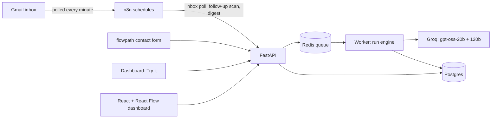

# AutoHub

An AI assistant for **flowpath**, a small marketing studio in Lahore. It answers every new customer in seconds in English, Roman Urdu, Urdu or Arabic, fact-checks its own replies against the studio's website, follows up when a good lead goes quiet, and plans the owner's morning. Anything it isn't sure about waits for the owner's OK.

Under the hood it's a small automation hub: every execution is a traced **run** of **steps** (input, output, model, tokens, cost, duration, retries), shown live on a React Flow canvas.

**Live demo:** _link coming after deploy_ · **Explore the demo** needs no sign-up

## Automations
| Automation | Trigger | What it does |
|---|---|---|
| **Lead Handler** | Email (polled every minute), website contact form, Try it | Classifies and scores the lead, drafts a reply from the knowledge base, fact-checks every claim, **removes what it can't back up and re-checks**, then sends on its own or holds it for the owner (with an English translation) |
| **Follow-up Nudge** | n8n, every morning | Finds hot and warm leads who went quiet 2+ days after our reply, drafts **one** gentle follow-up in their language, and runs it through the same fact check and rules |
| **Daily Digest** | n8n, 9 am | Emails the owner **today's top 3 tasks** (built by code from real data, put in order by the AI), then leads, replies, follow-ups, failures and AI cost |
| System Check | Manual | A 3-step smoke test: the configured models exist, a plain completion works, structured JSON validates |

Adding the Follow-up Nudge needed no changes to the engine: it's one class, one registry entry and one trigger, and it reuses the Lead Handler's fact check and the owner's rules.

## Architecture



**Two ways it runs:**
| | Local / real use (`docker compose up`) | Public demo (Render free plan) |
|---|---|---|
| Database | Postgres 16 | SQLite on the server's disk, refilled with sample data on every restart |
| Background work | Redis + RQ worker | In the API process (`RUN_MODE=inline`) |
| Schedules | n8n (inbox, follow-ups, digest) | None: visitors use Try it |
| Email | Gmail SMTP/IMAP, live or dry run | Dry run only, nothing is emailed |

The demo trades durability for cost: Render's free Postgres is deleted after 30 days, and a demo that resets itself never needs cleaning ([decision 61](docs/DECISIONS.md)). The tests run on both databases in CI.

**Core design:** every execution is a `Run` made of `RunStep`s. Step ids match the node ids in each automation's React Flow graph, so the dashboard can replay any run on its diagram.

## Stack
FastAPI · SQLAlchemy 2 · Alembic · Postgres (SQLite for the demo) · Redis + RQ · Groq (gpt-oss-20b, gpt-oss-120b) · Gmail SMTP/IMAP · n8n · React 19 + Vite + TypeScript + React Flow + TanStack Query · Docker · GitHub Actions · Render

## Run locally
```bash
cp .env.example .env          # add your GROQ_API_KEY
docker compose up --build
```
- Dashboard: http://localhost:5173 · API docs: http://localhost:8000/docs · n8n: http://localhost:5678
- Smoke test: `POST /api/automations/system_check/runs`, then `GET /api/runs/{id}`
- Sample leads in 4 languages: `docker compose exec api python scripts/demo_leads.py`
- Sample conversations without AI calls: `docker compose exec api python -m scripts.seed_demo`

## Lead Handler
```
intake → classify → retrieve → qualify → draft → score ─┬─ auto ─────────────────────────→ send ─┬→ save_lead
           └─ spam ─────────────────────────────────────┤                                         │
                                                         ├─ unsupported → revise → (re-check) ───┤
                                                         └─ review → translate → approval ───────┘ (approve / edit / reject)
```
- **classify** (20b): intent, language, and an English search query
- **retrieve**: BM25 over flowpath's site content, plus three passages the prompts always rely on
- **qualify** (20b): extracts services, budget, urgency; **code** scores the lead on flowpath's budget bands
- **draft** (120b): reply in the customer's language and style, only from the passages
- **score**: an LLM judge labels each claim (fact, commitment, restatement, courtesy) and whether the passages support it; **code** computes confidence and applies the owner's rules (unsupported claims, invented prices, review languages, existing clients, unoffered services)
- **revise**: one attempt to remove the unsupported statements, then the same check again
- **translate**: English version of held non-English replies, so the owner can approve what they can't read

## Follow-up Nudge
```
scan (n8n daily) → per quiet lead: pick → retrieve → draft → score ─┬─ auto → send ─────────────┬→ save
                                                                    └─ review → translate → approval ┘ (skip = never again)
```
- Due when: hot or warm, replied to by email between 2 and 14 days ago, no message from them since (`FOLLOW_UP_AFTER_DAYS`, `FOLLOW_UP_MAX_AGE_DAYS`)
- **Exactly once per lead:** the scan claims `follow_up:<lead id>` in `inbound_messages`, whose unique key makes a second claim fail even if two scans overlap
- `GET /api/follow-ups/due` previews; `POST /api/follow-ups/scan` starts the runs (n8n: `n8n/workflows/follow_ups.json`)

## Daily Digest
The AI never writes a task. Code builds the candidates from the database (replies waiting and for how long, hot leads who asked for a call, hot leads still quiet after their follow-up, failed runs). The AI answers with task **ids** in order plus a short reason; unknown ids and reasons containing numbers are dropped, and code's own order is used if the AI call fails. Home shows the same list. Preview: `GET /api/digest/preview`.

## Channels
Every reply leaves through one function (`send_reply` in `channels.py`) and every outside event (an email, a form post, a follow-up scan) enters through one (`start_once` in `intake.py`, deduplicated by a unique id), so channels and triggers are pluggable. WhatsApp was built and tested this way, then removed because Meta only lets verified businesses send ([decision 53](docs/DECISIONS.md)).
- **Email:** setup in [docs/EMAIL_SETUP.md](docs/EMAIL_SETUP.md). Auto-replies, newsletters, bounces and no-reply senders are never answered.
- **Website contact form:** `POST /api/forms/contact`. Only origins in `FORM_ALLOWED_ORIGINS`, a honeypot field, rate limits per email and IP, and a double-click starts one run.
- Sending needs `SEND_MODE=live`; `EMAIL_SEND_ALLOWLIST` limits who can receive while testing. Otherwise every send is a recorded dry run.

## Reliability
- **No double sends.** Deciding an approval, starting a run and resuming one are each a single conditional `UPDATE ... WHERE status = ?`; only one caller can win, so two clicks or a job delivered twice can't send twice ([decision 69](docs/DECISIONS.md)).
- **Safe retries.** LLM calls retry only transient errors (429, 5xx, timeouts) with jittered backoff and `Retry-After`. A failed run that already sent its reply can't be retried from the start; an allowed retry keeps the failed attempt's steps.
- **Interrupted runs** (server restarted mid-run) are marked failed on startup instead of saying "running" forever.
- **Structured output with self-repair.** Model output is validated against a Pydantic schema; on failure the errors go back to the model once.
- **Login:** signed HttpOnly cookies, three roles (owner, demo visitor, machine key for n8n), and 5 wrong passwords per address locks it out for 15 minutes.

## Dashboard
Built for the **business owner**, with the engineering one switch away. Plain words, rupees and next steps by default; flip **Technical details** (top right) and every screen also shows models, tokens, latency, raw step data, run graphs and heatmaps.

| Page | For the owner | With Technical details on |
|---|---|---|
| Home | today's customers, reply time, hot leads, cost in rupees; **today's top 3 tasks**; a live React Flow canvas where customers appear on the step the assistant is at; replies waiting for an OK | per-step latency and cost, heatmap link |
| Conversations → one conversation | the chat (including the follow-up), how the assistant handled it step by step with a replay, the fact check, lead score with reasons, a suggested next step | model / tokens / ms / cost per step, raw input and output, the run graph |
| Needs you | why each reply or follow-up was held, in plain words; the draft to approve, edit or skip; the fact check; an English translation | confidence, retrieval scores, link to the run |
| Leads | possible clients sorted by score | reply confidence |
| Rules | when the assistant may reply alone (applies to follow-ups too); **"if these rules had been on last week"** preview | the threshold and how the replay works |
| runs, automations | (technical only) | every run of every automation; heatmap by latency, cost or failure rate |

React 19, TypeScript, Vite, @xyflow/react, TanStack Query; plain CSS, no UI kit. Owner name, business name and the rupee rate are in `frontend/src/config.ts`.

## Evals: does it actually work?
Two hand-labelled sets in `backend/evals/`, run through the real pipeline with the real models: **40 customer messages** (10 per language) and **16 replies** for the fact checker, half with a planted false claim.

```bash
docker compose exec api python -m evals.run            # about 10–15 minutes on the Groq free plan
docker compose exec api python -m evals.run --limit 2  # quick check
```

Latest full run (1 Nov 2026):
| | English | Roman Urdu | Urdu | Arabic | All |
|---|---|---|---|---|---|
| Understood the request (intent) | 100% | 90% | 100% | 90% | 95% |
| Detected the language* | 90% | 90% | 100% | 80% | 90% |
| Picked out the services | 100% | 100% | 100% | 100% | 100% |
| Read the budget correctly | 100% | 100% | 100% | 100% | 100% |
| Fact check caught a planted false claim | 100% | 100% | 100% | 50% | 88% |
| Fact check false alarms on clean replies | 0% | 0% | 0% | 50% | 12% |
| **Sent alone when it should have asked** | 0 | 0 | 0 | 0 | **0** |

\*This run counted two spam messages (no reply is written for spam); the scorer now skips language for spam.

**What it means:** no reply in any language went out on its own when a person should have seen it. Arabic is the weak language (2 language misses, and 1 of its 2 planted claims slipped past the checker), so Arabic replies stay on review. The checker set is small (2 planted claims per language), so its percentages are indicative, not precise. Full output: [backend/evals/RESULTS.md](backend/evals/RESULTS.md).

## Tests and CI
127 tests, no key or network needed (a scripted fake of the Groq SDK). GitHub Actions on every push: tests on SQLite **and on Postgres**, dashboard type-check and build, and the production Docker image built and started with a `/health` check. Evals run by hand (Actions → Evals) because they cost real model calls.
```bash
cd backend && pip install -r requirements.txt && pytest -q
```

## Deploying
One Render web service runs the API and the dashboard together (`Dockerfile`, `render.yaml`). Visitors can **Explore the demo** without a password; the owner logs in. Step by step: [docs/DEPLOY.md](docs/DEPLOY.md). Database changes are Alembic migrations, applied on start.

## Project layout
```
backend/app/
  config.py        settings from env
  db.py            engine, sessions, Alembic on startup
  models.py        Automation, Run, RunStep, Approval, Lead, InboundMessage, AppSetting
  registry.py      the automations and their React Flow graphs
  engine/          run engine: step tracer (context.py), executor + claims + retry + recovery, queue dispatch
  automations/     lead_handler, lead_rules, follow_up, daily_digest, system_check
  llm/             Groq client: retries, cost, JSON validation + self-repair
  knowledge/       flowpath's content + BM25 search
  channels.py      outbound email: dry run, live, allowlist
  intake.py        outside event → exactly one run (email, form, follow-up scan)
  email_inbox.py   reads the inbox: parsing, loop guards, dedupe
  auth.py, ratelimit.py   signed-cookie login, roles, rate limits
  rules_store.py   the owner's rules (env values are the defaults)
  demo.py          sample data through the real pipeline, AI answers pre-written
  api/             routes: auth, leads + approvals, follow_ups, forms, email, digest, rules, runs, stats, health
backend/migrations/  Alembic
backend/evals/       labelled sets + runner
backend/tests/       pytest
n8n/workflows/       inbox_check.json, follow_ups.json, daily_digest.json
frontend/            the dashboard
docs/                DECISIONS.md (75 decisions with trade-offs), DEPLOY.md, EMAIL_SETUP.md
```

## Design decisions
Full log with trade-offs: [docs/DECISIONS.md](docs/DECISIONS.md). Highlights:
- **The model advises, code decides.** The judge labels claims; routing is a pure function over those labels, so it's testable, repeatable and can be replayed under new rules without AI calls. The digest's AI can only choose from task ids.
- **Runs and steps as first-class data.** Cost, latency and failures are visible per step for every automation, with no extra work in automation code.
- **Exactly once, enforced by the database.** Unique ids for incoming events, conditional updates for status changes.
- **BM25, not embeddings.** About 20 short passages; keyword search is exact, explainable and free ([decision 15](docs/DECISIONS.md)).
- **One automation done well first.** The Lead Handler got evals and a fact check before a second automation was added.

## Roadmap
- [x] Phase 0: Foundation
- [x] Phase 1: Run engine (tracing, retries, Groq client, cost)
- [x] Phase 2: Lead Handler
- [~] Phase 3: Document Extractor: dropped ([decision 60](docs/DECISIONS.md))
- [x] Phase 4: Channels: email + website form, n8n digest
- [x] Phase 5: Dashboard + React Flow run visualizer
- [x] Phase 6: Evals + CI
- [x] Phase 7: Deploy: login, migrations, Render blueprint, self-refilling demo
- [x] Phase 8: Follow-up Nudge, "Today" tasks in the digest, no-double-send guarantees, Postgres in CI
