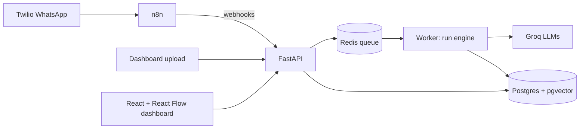

# AutoHub

One hub where AI automations run, every run traced step by step, with a human in the loop when the AI isn't confident.

**Automations**
| Automation | Trigger | What it does |
|---|---|---|
| Lead Handler | WhatsApp / email webhook | Classifies intent, answers from a knowledge base, auto-sends or queues for approval |
| Document Extractor | File upload | Vision extraction of invoices/receipts → validation → self-correction → human review |
| Daily Digest | n8n schedule | Morning summary of leads, documents and pending approvals |

## Architecture



**Core design:** every execution is a `Run` made of `RunStep`s. Each step stores input, output, model, tokens, cost, duration and retry count. Step ids match the node ids in each automation's React Flow graph, so the dashboard can replay any run on its diagram.

## Stack
FastAPI · SQLAlchemy · Postgres + pgvector · Redis + RQ · Groq · fastembed · Twilio · n8n · React + Vite + React Flow · Render

## Run locally
```bash
cp .env.example .env          # add GROQ_API_KEY later (Phase 1)
docker compose up --build
```
- API docs: http://localhost:8000/docs
- Health: http://localhost:8000/health
- n8n: http://localhost:5678

Tests (no Docker needed, uses SQLite):
```bash
cd backend
pip install -r requirements.txt
DATABASE_URL=sqlite:///./test.db pytest -q
```

## Project layout
```
backend/app/
  config.py      settings from env
  db.py          engine, sessions, table creation
  models.py      Automation, Run, RunStep, Approval, Lead, Document
  registry.py    the 3 automations + their React Flow graphs
  schemas.py     API response shapes
  api/           routes (health, automations, runs)
backend/tests/   pytest
n8n/workflows/   exported n8n workflow JSON
frontend/        dashboard (Phase 5)
```

## Design decisions
- **Runs and steps as first-class data.** Observability is built into the hub, not bolted on: cost, latency and failures are visible per step for every automation.
- **Enums stored as strings.** Readable in the database and no Postgres enum migrations when a status is added.
- **Graph stored on the automation.** The backend owns the workflow shape, so the dashboard never hardcodes it.
- **Health reports each dependency.** Redis down means "degraded" (background jobs pause), not "down".

## Roadmap
- [x] Phase 0: Foundation
- [ ] Phase 1: Run engine (tracing, retries, Groq client, cost)
- [ ] Phase 2: Lead Handler agent
- [ ] Phase 3: Document Extractor
- [ ] Phase 4: n8n + Twilio WhatsApp
- [ ] Phase 5: Dashboard + React Flow run visualizer
- [ ] Phase 6: Evals + CI
- [ ] Phase 7: Deploy + demo
